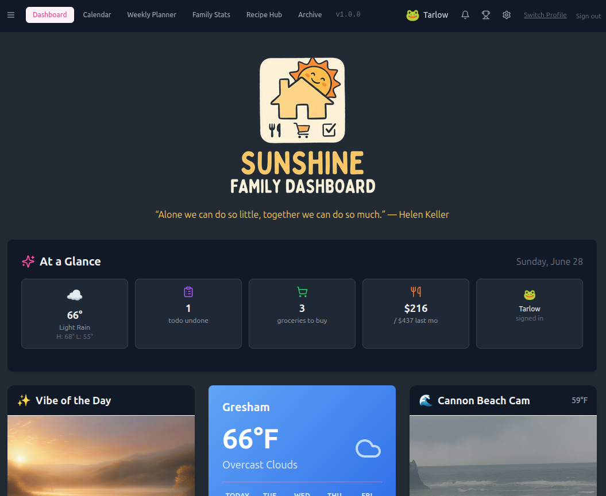
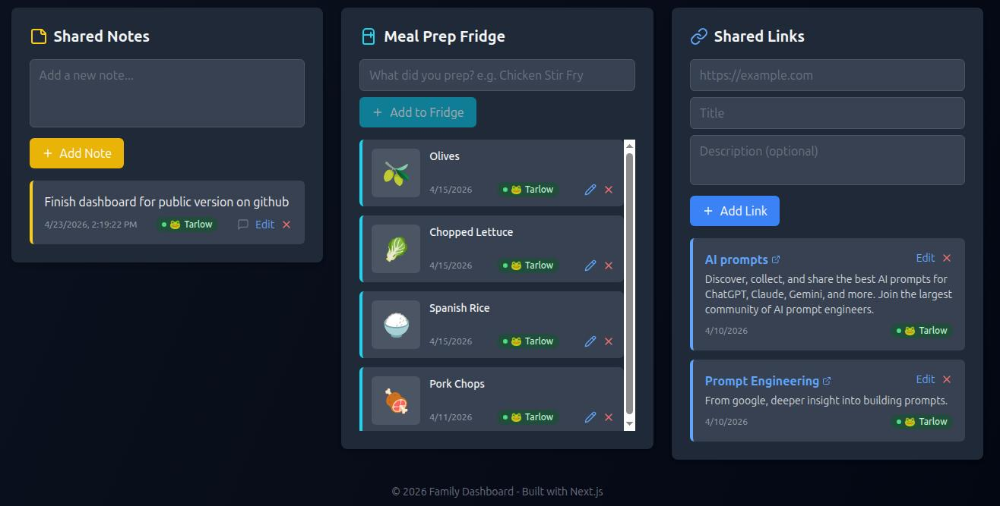

## Sunshine Family Dashboard is on GitHub

I just put my first public project on GitHub: the [Sunshine Family Dashboard](https://github.com/DevTarlow/sunshine-family-dashboard).

It has been a lot of fun building this, and it feels good to finally have both the blog and the dashboard out in the open instead of sitting in local folders.

The Sunshine Family Dashboard is a lightweight, self-hosted dashboard that you and your family can run on your own network to stay on the same page.

I built it because I wanted to get comfortable with newer tools while making something my wife and I would actually open every day. I figured if it ended up being useful enough for us to stick with, other families might want to run it too. If even one other household gets some value out of it, that makes sharing it worth it.

## How we got it built fast

While building this out, I leaned on [GitHub Copilot in VS Code](https://github.com/features/copilot), [Gemini](https://gemini.google/about/), and local models running in [LM Studio](https://lmstudio.ai/).

For me, the slowest part was not typing out components. It was deciding what should actually go on the screen and what features were worth keeping. Asking myself those questions while using it with my wife made it obvious what stayed and what got cut, so we did not waste time building panels nobody opened.

## Why local-first matters

We wanted our data to stay ours. When an app tracks your daily notes, tasks, meal plans, and routines, that is a lot of personal information about your household.

So we kept the dashboard local-first. Everything sits on your own machine in a local Prisma database, and you can delete it whenever you want without worrying about who else is storing it.

Only two panels reach outside your local network:

- **Weather:** sends a request to [OpenWeatherMap](https://openweathermap.org/) to pull current conditions.
- **Live Camera Snapshot:** an optional panel that takes a single camera URL and uses a cachebuster to grab a fresh image on each refresh. We use it to check the beach weather.

Everything else stays on your device.

## Features built for real life

Having one shared spot for the house has been really helpful. We use it to stay accountable on workouts, check the beach camera, track the weather, plan weekly dinners, and see what leftovers are in the fridge *(along with the date they went in, so no more guessing on unlabeled containers)*.

The little day-to-day interactions are what make it stick. For example: I usually plan out the weekly dinners, and if my wife wants to add something to a meal or let me know she picked up salmon, she drops a quick note right on the dashboard. Or if we both get busy and decide to go out to eat, we just drag that night's dinner over to the next day.

If you hook up your own local LLM, the dashboard can also suggest dinner ideas that are not already on your weekly list, give you custom toast alerts, and automatically add matching emojis to items in the Meal Prep Fridge panel.

Instead of trying to remember what is in the fridge, what we spent eating out, or what needs to happen tonight, we just check one screen. If you give it a try, I hope you and your family get as much use out of it as we do.

## Check out the project page

> [Sunshine Family Dashboard - Project Page](/projects/sunshine-family-dashboard/)
