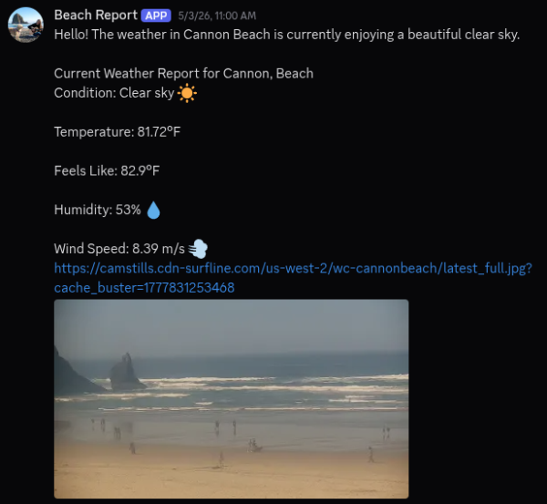

## Why local LLMs matter

When I am working on sensitive notes or private projects, I don't want to send that data out to an external server just to ask a model a question. Running an LLM locally keeps everything on your own computer.

Another real upside is working offline. I keep local models on my main PC, laptop, and phone so I always have something handy even without an internet connection.

Are local models as strong as the giant frontier models hosted by big companies? No. We can't fit those on consumer hardware. But smaller local models have gotten a lot better, and for everyday tasks they hold up well.

Lately I have been using Google's Gemma 4 lineup. They are lightweight enough to fit on regular desktop hardware and support thinking, vision, and tool calling.

## What it takes to run a local LLM

Running a model at home is easier than it sounds. You can run smaller models on a phone, laptop, or desktop you already own. I do most of my heavier local work on my desktop.

The two numbers that matter most are the model file size and parameter count (which is roughly the size of the model). Bigger usually means stronger answers, though newer small models often beat older larger ones.

Gemma 4 comes in a few sizes, all capable of text, vision, audio, and reasoning:

- **Gemma 4 E2B IT:** 2 billion parameters. Small enough for phones and laptops.
- **Gemma 4 E4B IT:** 4 billion parameters. This is my daily driver for autonomous tasks because it is fast and reliable on a desktop or laptop.
- **Gemma 4 26B A4B IT:** 26 billion total parameters with 4 billion active. Needs a solid desktop GPU or dedicated hardware.
- **Gemma 4 31B IT:** 31 billion parameters. The largest in the lineup, built for heavier desktop or server hardware.

You can see the full model collection on [Hugging Face](https://huggingface.co/collections/google/gemma-4).

Which one you pick depends on your hardware and what you want it to do. Here is what I am running so you have a concrete baseline.

## My hardware and software setup

Desktop computer specs:

- CPU: 12th Gen Intel Core i5-12600K
- Graphics card: NVIDIA GeForce RTX 3060 12GB
- RAM: 64GB DDR4
- Storage: 256GB NVMe with extra SSD storage
- OS: Linux Mint Cinnamon
- Software: [LM Studio](https://lmstudio.ai/) with `google/gemma-4-e4b` and `gemma-4-26b-a4b` installed

You do not need this exact machine. The main constraint is VRAM, because you want enough video memory to load the model onto your graphics card.

LM Studio lets you pick how many layers to offload to your GPU along with context length, temperature, and other settings. If you don't offload enough layers to the GPU, generation slows down fast.

For example: on my 3060 12GB, I can load the Gemma 4 26B A4B IT model, but at around 12 tokens/sec it feels sluggish as a daily driver. Gemma 4 E4B IT runs around 20 tokens/sec, which feels responsive. On a 12GB card, 8B to 14B models hit the sweet spot between speed and quality; anything larger needs more VRAM or a second card.

If you have 8GB+ of VRAM, starting with a 2B or 4B model gives a smooth experience. LM Studio also checks your specs and tells you which models will actually fit on your machine.

## Installing LM Studio and running Gemma 4

1. Go to <https://lmstudio.ai/> and download LM Studio for your OS.
2. Open the app, click the AI Model Search tab (magnifying glass icon), and search for `Gemma 4 2B`.
3. Pick a community GGUF version like `gemma-4-2b-it-GGUF` and click Download. ("it" stands for Instruction Tuned, which is what you want for chat.)
4. Once it finishes downloading, open the AI Chat tab and pick your model from the dropdown at the top.
5. Wait a few seconds for the model to load into memory, then start typing.

At that point you have an offline model running with no subscription and no data leaving your machine.

## Ways to use it right away

Once it is running, here are three practical things I use it for:

1. Summarize a rough draft. Paste your notes into chat and ask for a summary. You can tweak the system prompt in the right sidebar to control tone or format.
2. Generate frontmatter tags for blog posts. I use a prompt like this to get Astro tags:

```
I need you to create a list of SEO friendly keyword tags that I can use for my blog post. Give me the list in .md frontmatter format for astro of the top performing SEO keywords to use. Output the top 5 tags.

Example: tags: [ai, llm, tutorial]

Post:
your_content
```

3. Analyze images with vision. With Gemma 4, click the `+` button or drag a screenshot straight into chat and ask questions about it.

## Hooking it up to local automations

Once you are comfortable with LM Studio chat, you can flip on its local server and point other tools like n8n or VS Code at the OpenAI-compatible endpoint.



One of the first automations I built with it was my "Beach Report Bot" in n8n. Every morning at 10am, an AI Agent pulls the weather from OpenWeatherMap, formats a short report with the local model, attaches a fresh beach cam image, and drops it into my Discord channel.

If you set up a local model or build a workflow with it, share what you are running with me on [Bluesky](https://bsky.app/profile/itstarlow.bsky.social).
