I wanted a weather report sent straight to my Discord each morning, so I built this workflow.

Every morning it grabs our local beach weather *(with a cam snapshot)* and drops it into a channel. It was also one of the projects that got me comfortable hooking local LLMs up to real workflows, so here is how to set the whole thing up with n8n and LM Studio.

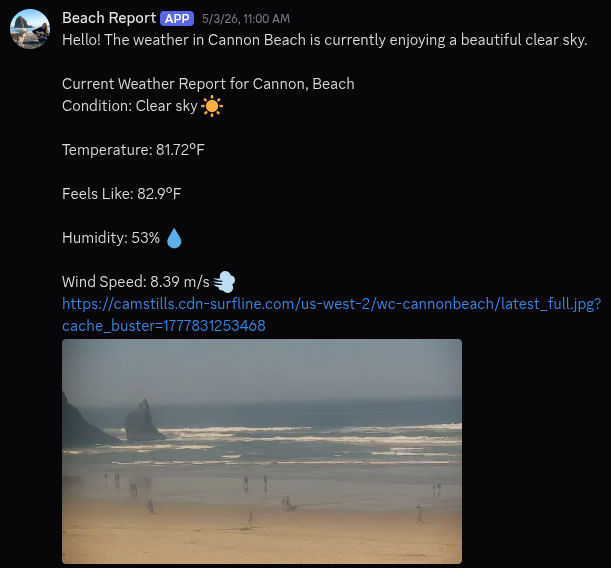
*(Here is a screenshot of my weather report bot message in Discord)*

## What we are building

The workflow fetches raw weather data, hands it to a local LLM in LM Studio to format into a clean report, and sends the message to Discord.

By the end, you will set up:

- An OpenWeatherMap API key
- Self-hosted n8n running in Docker
- LM Studio with a local model and its local server enabled
- A Discord Webhook URL

## What you need first

Adjust this baseline to fit whatever hardware you have:

- n8n (self-hosted or cloud)
- Docker (for the n8n container)
- LM Studio with a model loaded (I am using Gemma 4 4B QAT)
- A GPU with at least 8GB VRAM for Gemma 4 4B QAT (or a smaller model if you have less VRAM)
- An OpenWeatherMap API key
- A Discord Webhook URL

### Installing Docker

n8n runs cleanly inside Docker so you don't have to fight OS or dependency differences.

Step 1: Go to <https://docs.docker.com/get-started/get-docker/> and follow the instructions for your OS to install Docker Desktop (which includes Docker Engine and Docker Compose).

### Installing n8n

n8n is a node-based automation tool that lets you wire APIs, schedules, and LLM calls together without writing everything from scratch. Here we use the free self-hosted setup.

Step 1: Follow the Docker installation instructions at <https://docs.n8n.io/hosting/installation/docker/>.

Step 2: Start n8n from your terminal, replacing `<YOUR_TIMEZONE>` with [your timezone](https://en.wikipedia.org/wiki/List_of_tz_database_time_zones#List):

```
docker volume create n8n_data

docker run -it --rm \
 --name n8n \
 -p 5678:5678 \
 -e GENERIC_TIMEZONE="<YOUR_TIMEZONE>" \
 -e TZ="<YOUR_TIMEZONE>" \
 -e N8N_ENFORCE_SETTINGS_FILE_PERMISSIONS=true \
 -e N8N_RUNNERS_ENABLED=true \
 -v n8n_data:/home/node/.n8n \
 docker.n8n.io/n8nio/n8n
```

This creates a persistent volume for your workflows, pulls the n8n image, and runs it on port `5678`:

- Exposes port `5678` on your machine.
- Sets `TZ` and [`GENERIC_TIMEZONE`](https://docs.n8n.io/hosting/configuration/environment-variables/timezone-localization/) so schedule triggers fire at your local time.
- Enforces settings file permissions and enables [task runners](https://docs.n8n.io/hosting/configuration/task-runners/).
- Mounts `n8n_data` to `/home/node/.n8n` so your workflows survive restarts.

Once it starts, open [http://localhost:5678](http://localhost:5678/) in your browser. Next time you start it, skip the `docker volume create n8n_data` line since the volume already exists.

Here is the exact command I run on my machine (you may need `sudo` depending on your Docker setup):

```
docker run -it --rm \
 --name n8n \
 -p 5678:5678 \
 -e GENERIC_TIMEZONE="America/Los_Angeles" \
 -e TZ="America/Los_Angeles" \
 -e N8N_BLOCK_FS_WRITE_ACCESS=false \
 -e N8N_RESTRICT_FILE_ACCESS_TO="/data" \
 -e N8N_RUNNERS_ENABLED=true \
 -v n8n_data:/home/node/.n8n \
 docker.n8n.io/n8nio/n8n
```

### Installing LM Studio and loading a local model

LM Studio is one of the easiest ways to run local LLMs on a laptop or desktop, and it tells you upfront which models fit on your hardware.

Step 1: Download LM Studio for your OS from <https://lmstudio.ai/download>. (On Linux Mint, I grabbed the `.deb` package.)

Step 2: Open LM Studio and grab a model. For this guide I am using Gemma 4 4B it QAT (4B parameters, instruction tuned, Quantization-Aware Training). It is fast and fits comfortably on an 8GB VRAM card.

Click the **Model Search** icon in the left sidebar and search for:

`lmstudio-community/gemma-4-E4B-it-QAT-GGUF`

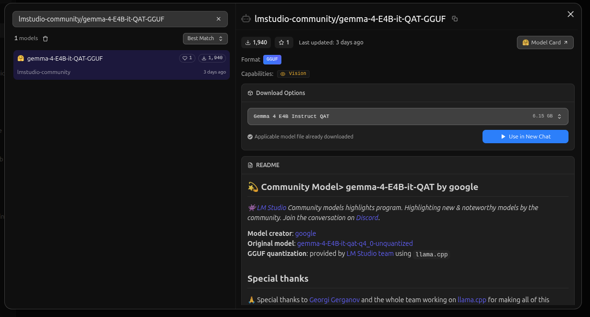

Download the model before moving to the next step.

Step 3: Open the **Developer** tab in the left sidebar (enable it in Settings if you don't see it), click **+ Load Model**, and select the model you just downloaded. LM Studio picks sensible defaults for your GPU and RAM.

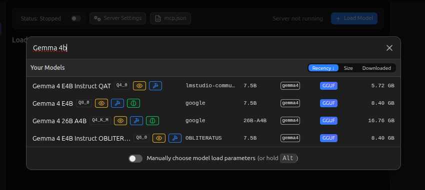

Step 4: Open the **Chat** tab, select the model at the top under "Select a model to load", click **New Chat**, and send a quick test message. If it replies cleanly, you are good. (If it fails to load, you likely need a smaller model or fewer GPU layers for your VRAM.)

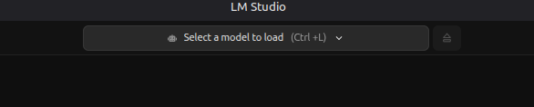

Step 5: Turn on the local server so n8n can reach the model. Go back to the **Developer** tab, make sure the model is loaded, and flip the toggle next to **Status: Stopped**.

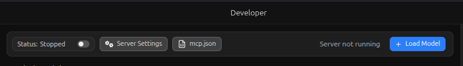

Your local server is now listening at `http://localhost:1234/` (or the port configured in your LM Studio server settings) with everything staying on your own machine.

### Setting up the OpenWeatherMap API key

OpenWeatherMap gives you a free tier with up to 50 calls per minute and 1 million calls per month, which is plenty for a daily workflow.

Step 1: Go to <https://openweathermap.org/>, click "Get API Key", and create an account if you don't have one.

Step 2: Open the **API keys** tab, type a name for your key under **Create key**, and click **Generate**. Keep that key handy.

### Setting up the Discord Webhook URL

Step 1: Open the Discord server and channel where you want the daily report posted. Click the server name -> Server Settings -> Apps -> Integrations -> Webhooks.

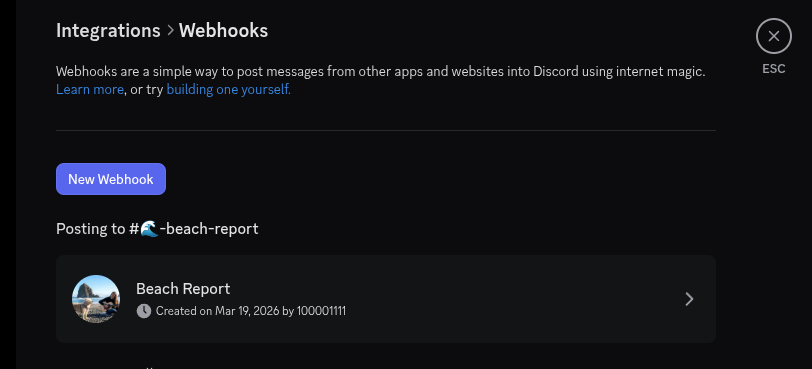

Click **New Webhook**, name it, choose the target channel, and click **Copy Webhook URL**. You can also upload a custom avatar for the bot here.

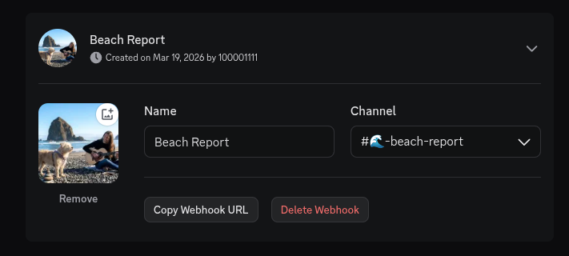

## Building the workflow in n8n

The flow is simple:

Schedule Trigger -> AI Agent using OpenWeatherMap tool -> Discord Node

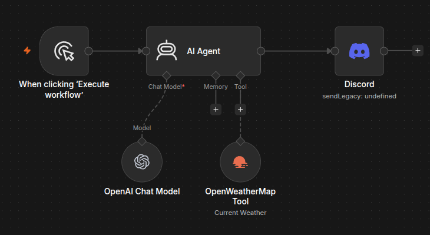

Step 1: Open <http://localhost:5678/> and click **Create Workflow**.

### Trigger Manually node

Step 2: Click `+` on the canvas (or right-click) and add the **Trigger Manually** node so we can test on demand. Once everything works, swap this for a **Schedule Trigger** node set to run each morning.

### AI Agent node

Step 3: Add an **AI Agent** node and double-click to open it. Set "Source for Prompt (User Message)" to **Define Below**, then paste this into the Prompt field:

```
Step 1: Data Retrieval
Call the "OpenWeatherMap tool" to give me the weather report.

Step 2: Formatting Rules
Create a report using the following structure. Do not include the bracketed labels in the final text; only the values.

Greeting: Start with a natural greeting and a 1-sentence summary of the conditions.

Structure: Use the following Markdown template exactly:

Current Weather Report:
Condition: [Description] [Emoji]

Temperature: [Value]°F

Feels Like: [Value]°F

Humidity: [Value]% 💧

Wind Speed: [Value] m/s 💨

Step 3: Quality Control

Remove all placeholder text or "Notes" from the final response.

Ensure the "Condition" emoji matches the weather description.

Final Action: Deliver the formatted report directly to the user.
```

Step 4: In the **System Message** field, paste these instructions so the model outputs only the formatted report with no extra filler:

```
# Role: You are a specialized weather reporting agent. You excel at translating raw JSON data from tools into professional, user-friendly reports.

# Role Objective: Generate a weather report using ONLY data retrieved from the 'OpenWeatherMap tool' when prompted by the user.

# Constraints: No Meta-Talk: Do not include instructions, placeholders, or technical warnings (e.g., "Replace your API ID") in the final output.

# No Filler: Provide only the greeting and the weather data. Do not explain your process.

# Units: Ensure temperatures are displayed in the unit requested by the user. If the tool returns Kelvin, convert it to Celsius or Fahrenheit before outputting.
```

Close the AI Agent panel so we can wire up the Chat Model and Tool connectors underneath it.

Step 5: Under the AI Agent node, click `+` on **Chat Model** and pick **OpenAI Chat Model**. Under Credential, click **+ Create new credential**:

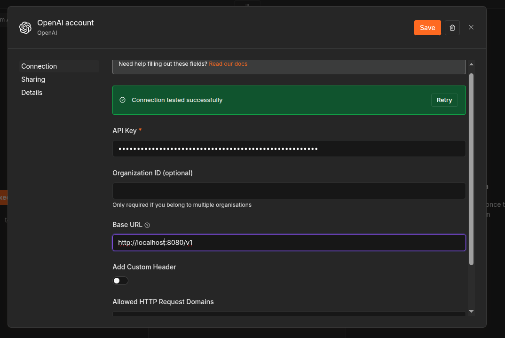

- API Key: enter anything non-empty (for example `weather`), since LM Studio ignores it locally.
- Base URL: enter your local LM Studio OpenAI endpoint (for example `http://localhost:8080/v1`, matching the port shown in your LM Studio Developer server panel).
- Click **Save**, then pick your loaded Gemma 4 model from the model list. *(If the dropdown is empty, double-check that the model is loaded and the local server is running in LM Studio.)*

Step 6: Click `+` on **Tool** under the AI Agent and pick **OpenWeatherMap Tool**. Create a new credential and paste in your OpenWeatherMap **Access token** (API key), then save.

Set the OpenWeatherMap node options:

- Tool Description: Set Automatically
- Operation: Current Weather
- Format: Imperial (or Metric for Celsius)
- Location Selection: City ID (search your city on OpenWeatherMap and grab the trailing number in the URL, e.g. `https://openweathermap.org/city/5746545`)
- Language: `en`

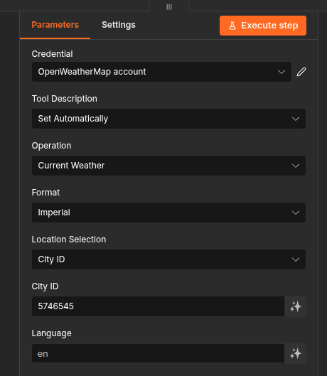

Your workflow should now look like this:

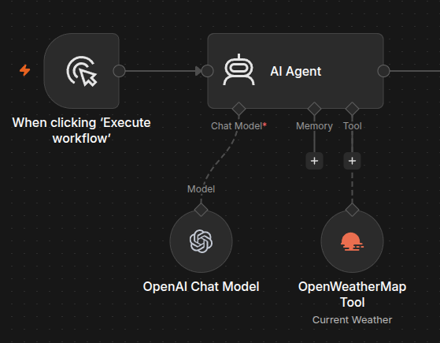

### Adding the Discord node

Step 7: Click `+` after the AI Agent, search for **Discord**, and configure it:

- Connection Type: Webhook
- Credential for Discord Webhook: add a new credential with your copied Discord Webhook URL and save
- Operation: Send a Message
- Message: `{{ $json.output }}`

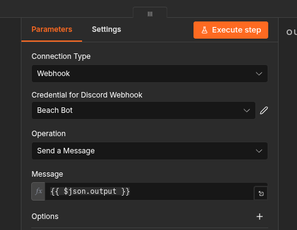

## Testing the workflow


Click **Execute Workflow**. The agent calls OpenWeatherMap, formats the forecast with your local model, and posts it to your Discord channel.

Once that works, swap the manual trigger for a Schedule Trigger to get it automatically every morning. In my own setup I also fetch a snapshot from a local beach cam and attach it to the message.
