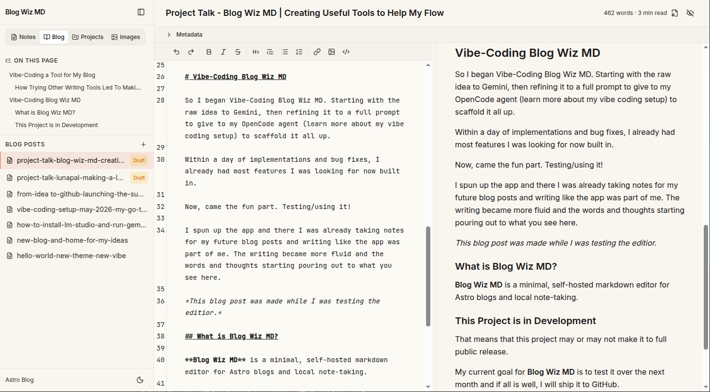

## Getting friction out of my writing flow

When I started this Astro blog, I figured I would enjoy writing posts right inside VS Code while learning more markdown along the way.

It didn't really stick. Every time I opened VS Code to draft a post, it felt like I was sitting down to code instead of write. Even stripping the UI down to zen mode didn't fix that feeling.

Next I tried drafting in Obsidian and copying posts over to the blog, which also felt clunky. I looked into hooking Obsidian straight up to the repo and even tested Syncthing to keep drafts synced between my desktop and laptop, but none of those setups felt integrated the way I wanted.

It reminded me of something my dad used to tell me:

> "If you want something done right, then you gotta do it yourself."

So I started building my own markdown editor to manage my blog posts and projects: **Blog Wiz MD**.

## Building Blog Wiz MD

I took the rough idea into Gemini to flesh out the spec, then passed the plan to my OpenCode agent ([my May coding setup is here](/blog/vibe-coding-setup-may-2026-my-go-to-stack/)) to scaffold the app. Within a day of building and fixing bugs, most of the core features I wanted were working.

Then came the real test: actually writing inside it.

I spun up the app and started drafting notes for future posts, and right away it felt natural. The words came out easily, and I actually wrote the first draft of this post inside the editor while testing it.

Then I lost the whole draft because I was writing inside an app I was actively modifying while it ran. That is on me for trusting an in-progress dev build without saving a copy elsewhere. Fortunately I had taken a screenshot while testing, so I didn't lose everything.

## What Blog Wiz MD is

**Blog Wiz MD** is a minimal, self-hosted markdown editor built for Astro blogs. It handles blog posts, project entries, and quick notes in one place, and it is still under active testing and development.

Check out the full feature list on the project page: [Blog Wiz MD](/projects/blog-wiz-md/)
