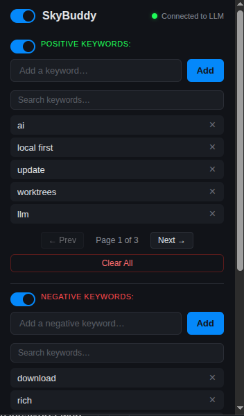
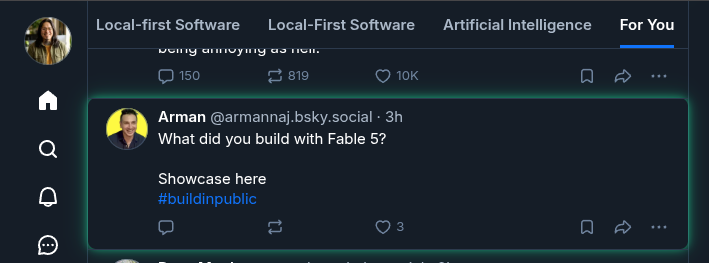

I kept scrolling through Bluesky, finding posts I genuinely wanted to reply to, and drawing a blank on how to word a decent response without spending ten minutes overthinking it.

That is when I thought about adding a button right inside the reply box that sends the post to my local Gemma 4 model, drafts a reply using a system prompt, and drops it in so I can tweak it before hitting post. Together with a keyword filter I had built earlier for Reddit, that turned into SkyBuddy.

## What SkyBuddy does

SkyBuddy is a Chrome extension for Bluesky that highlights posts matching keywords you care about, hides topics you want filtered out, and drafts replies using your local LLM.

Keyword filtering settings:

A post matching one of my positive keywords:

The Magic Reply button and tone options:

## Why I built it

I wanted a faster way to find relevant conversations in my feed without wading through everything else. Positive keywords highlight the posts I want to see, and negative keywords hide the ones I want to skip.

When I hit reply on a post, SkyBuddy adds a Magic Reply button with five tone presets: Generic, Agree, Disagree, Funny, and Informative. Each tone uses its own system prompt on the local LLM. Instead of starting from an empty box every time, I get a solid rough draft in seconds, adjust it so it sounds right, and post.

It keeps my feed cleaner and cuts down how much time I spend staring at social media.

## Where it is right now

The core extension works, though it is still in development. Next I want to tune the system prompts for each tone and speed up the local LLM response handling.

Right now the generated replies are a good starting point rather than perfect out of the box. Once the prompts feel solid and I finish a final pass on the UI, I plan to submit it to the Chrome Web Store.

You can check out the full write-up on the [SkyBuddy project page](https://tarlow.space/projects/skybuddy/) or grab the source code on [GitHub](https://github.com/DevTarlow/SkyBuddy).
