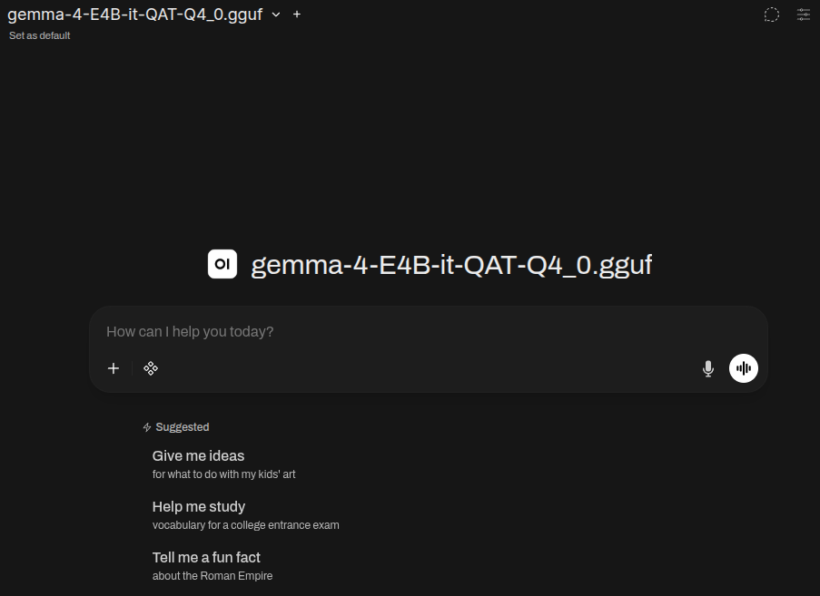
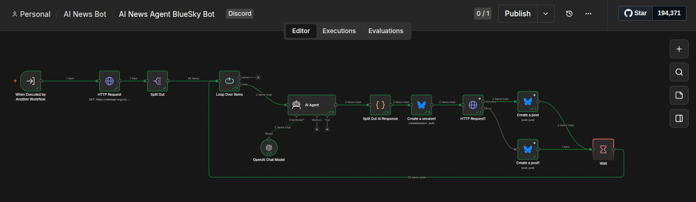
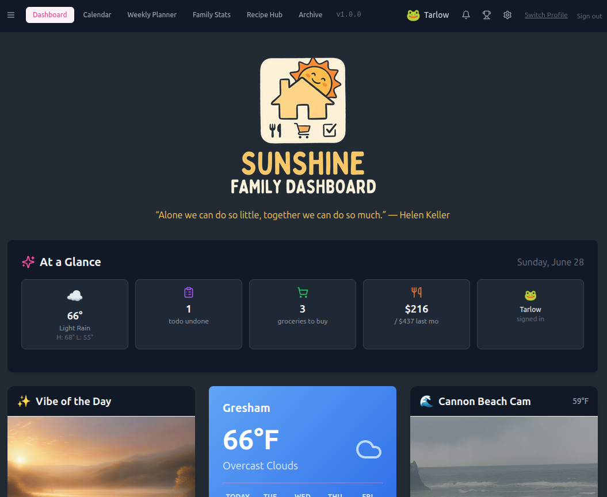
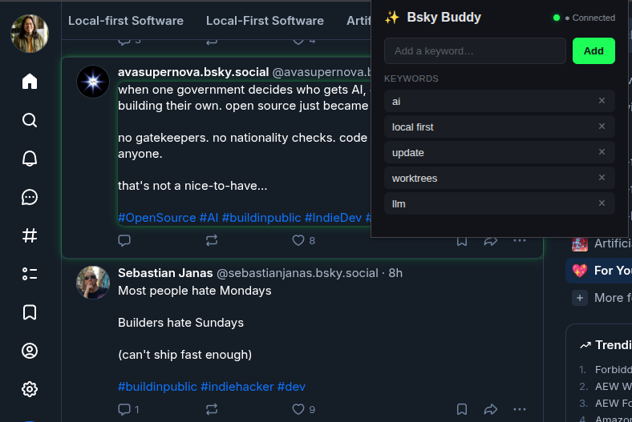
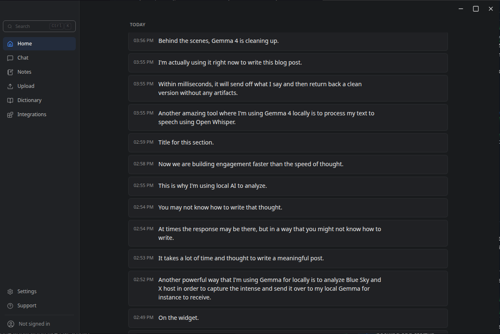

More and more lately, hosted AI providers release strong models and then tighten access, raise prices, or add heavy restrictions around how you can use them. You build a workflow around an API, and a few months later the terms or pricing shift under your feet.

Running models on your own hardware fixes both problems. You keep your data on your own machine, and once you have the hardware, running prompts locally doesn't cost you per token.

Using Gemma 4 locally lets me power my open-source projects, automations, and daily tools without sending private notes or business ideas to a cloud API. Here is a look at the tools I have hooked up to it right now.

## Why keep it local

When I am testing prototype ideas, writing personal notes, or working with family data, I don't want any of that stored or trained on by an outside provider. Keeping everything on my desktop means I control where the data goes, and I can tweak model settings, context windows, and system prompts without being boxed in by one hosted endpoint.

Aside from electricity and the hardware I already own, there are no monthly API bills attached to experimenting all day.

## Why I landed on Gemma 4

I tested a bunch of local models including Llama, Qwen, Nemotron, and gpt-oss. The main reason I stuck with Gemma 4 is the range of sizes and steady support:

- 2B and 4B effective parameter models for laptops, phones, and edge setups
- A 12B encoder-free multimodal model that handles text, vision, and audio
- A 26B Mixture-of-Experts model for heavier reasoning at higher speed
- A 31B dense model when you have the VRAM for top local quality

For my own daily setup, I mostly run the 4B QAT (Quantization-Aware Training) model because it gives me good speed and efficiency on my hardware. Google has a breakdown of how it works in their [Gemma 4 QAT post](https://blog.google/innovation-and-ai/technology/developers-tools/quantization-aware-training-gemma-4/).

If you are starting from scratch, I wrote a [step-by-step guide on installing LM Studio and running Gemma 4](/blog/how-to-install-lm-studio-and-run-gemma4-locally-for-private-llm-use/). Since then I have moved to using `llama.cpp` directly (the engine under LM Studio and Ollama) because it cuts out the wrapper overhead and runs faster.

## How I use Gemma 4 day to day

### Chat interface: Open WebUI

For everyday questions, testing prompt ideas, or talking through prototypes I want to keep private, I use Open WebUI. It feels familiar if you have used ChatGPT, keeps your chat logs local, and supports MCP integrations and custom agents.

### Automations: n8n agents

In n8n, I wire Gemma 4 into AI Agent nodes to summarize incoming data, route tasks, and post updates. One example is my AI news bot for Bluesky: it pulls recent AI posts from an API, summarizes them with the local model, adds relevant hashtags, and posts the update automatically.

### Local apps: Sunshine Family Dashboard

My wife and I use the Sunshine Family Dashboard every day for meal planning, notes, photos, and schedules. Gemma 4 powers the meal prep fridge widget: when we add an item, a structured prompt estimates when it will spoil so we remember to eat leftovers before they go bad.

### Browser tools: SkyBuddy for social replies

Writing thoughtful replies on Bluesky and X takes time, especially when you know roughly what you want to say but don't feel like staring at a blank reply box. I built a Chrome extension that highlights posts matching my keyword list with a green border, sends the post text to my local Gemma 4 server, and drafts a reply I can quickly edit before posting.

### Voice to text: OpenWhispr

OpenWhispr runs speech-to-text locally on my hardware, and I pass the transcript through Gemma 4 to clean up stutters and filler words in milliseconds. That is actually how I drafted the rough notes for this post.

## Where to start if you are new to this

There are a lot of models and tools floating around, and it is easy to get overwhelmed trying to wire everything up on day one.

Start with one tool like LM Studio so you can see how downloading, loading, and prompting a model works on your hardware. Once that feels routine, hook that local endpoint into a simple automation in n8n or a small script you will actually use every week.

What would you put on a local model first if none of your data had to leave your machine?
