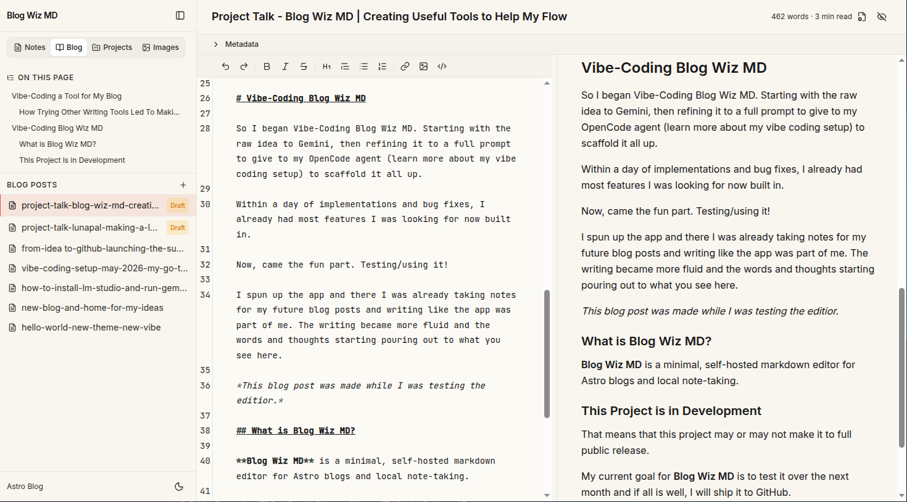

I wanted a clean place to draft markdown files for my blog posts and projects without digging through source folders inside a code editor every time I wanted to write.

So I built Blog Wiz MD, a self-hosted markdown editor tailored to my Astro blog that keeps blog posts, project pages, and quick notes together in one app.

## Features

**Notes mode** (local SQLite-backed documents):
- Create, delete, search, pin/unpin, and drag-and-drop notes across folders
- CodeMirror 6 editor with syntax highlighting, line numbers, line wrapping, and auto-save
- Resizable split-pane live markdown preview, word count, and reading time

**Blog mode** (edits Astro content directly on disk):
- Browse, create, edit, and delete `.md`, `.mdoc`, and `.mdx` files
- Frontmatter editor for title, `pubDate`, draft toggle, description, tags, and hero image
- Auto-generated slugs for new posts

**Images mode**:
- Browse a configured image folder, upload up to 10MB via picker or drag-and-drop, and rename or delete files
- Copy markdown image embeds or drag images straight into the post editor

**General**:
- Light/dark theme toggle, auto-parsed Table of Contents sidebar, scroll sync, and collapsible sidebar

## Tech stack

| Layer | Choice |
|---|---|
| Framework | Next.js 16 (App Router, React 19) |
| Language | TypeScript 5 (strict) |
| Editor | CodeMirror 6 |
| Styling | Tailwind CSS 3, `tailwind-merge` / `clsx` |
| Database | SQLite via `better-sqlite3` + Drizzle ORM |
| Markdown | `react-markdown`, `remark-gfm`, `gray-matter` |
| Icons | Lucide React |
| Testing | Vitest, Testing Library |

## Status

- 5/18/2026 | Initial `1.0.0` alpha under active development.
