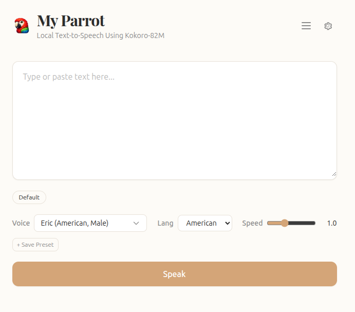

My Parrot is a local-first web UI for the [Kokoro-82M](https://github.com/hexgrad/kokoro) text-to-speech model. Paste or type text, pick from 28 voices across American and British English, and generate speech locally with real-time progress streaming, no API keys, no word caps, and no subscriptions.

I built it because I wanted to proofread my blog drafts by listening to them, and every hosted TTS site I tried either capped word counts or wanted a monthly plan.

The model auto-detects CUDA on a GPU and falls back to CPU when needed. Inside the interface you get:

- A voice dropdown with 28 voices (11 American female, 9 American male, 4 British female, 4 British male), 2-second sample previews, and a `0.5x` to `2.0x` speed slider.
- A presets bar for saving favorite voice/speed/language combos as one-click pills.
- Phrase-by-phrase SSE progress updates while generating, followed by a WaveSurfer waveform player with play/pause and WAV download.
- A searchable, sortable History sidebar showing text snippets, voice used, and duration, with a 5-second undo toast on deletes.
- A Settings modal for dark mode, auto-play, history limits (50 to Unlimited), and system info (Python, PyTorch, CUDA, and GPU model).

## Features

- 28 voices (American and British English, male and female) with 2-second previews
- Real-time SSE streaming with phrase-level progress feedback
- WaveSurfer audio player and WAV export
- History sidebar with search, voice filter, sorting, and 5-second undo delete
- Saved presets, `0.5x`-`2.0x` speed control, dark mode, and `Ctrl+Enter`/`Cmd+Enter` shortcut
- Runs completely offline after initial model download from Hugging Face

## Tech stack

I kept the stack simple with no frontend build step:

- **Model & inference:** Kokoro-82M outputs 24kHz mono audio on a consumer GPU or CPU and caches locally after first download.
- **Backend:** FastAPI handles background audio generation and SSE streaming, managing lazy-loading, pre-warming, and CUDA cache cleanup.
- **Audio pipeline:** KPipeline splits text on sentence boundaries into phrases, concatenates numpy chunks, and writes 24kHz mono float32 WAV files via `soundfile`.
- **Frontend & storage:** A single HTML file using vanilla JavaScript, Tailwind CSS via CDN, and WaveSurfer.js. Audio saves in `~/.myparrot_audio/` and history lives in a flat `history.json` file with no database.

## Recent updates

- 7/3/2026 | [GitHub](https://github.com/DevTarlow/my-parrot) v1.0.0 - Initial release with SSE streaming, 28 voices, presets, history, and dark mode.

## Get the project

My Parrot is free and open source under the MIT license. Download it from GitHub and run it locally with Python on a GPU or CPU.

<a href="https://github.com/DevTarlow/my-parrot" class="project-link" target="_blank" rel="noopener noreferrer">
  <svg xmlns="http://www.w3.org/2000/svg" width="16" height="16" viewBox="0 0 24 24" fill="none" stroke="currentColor" stroke-width="2" stroke-linecap="round" stroke-linejoin="round">
    <path d="M9 19c-5 1.5-5-2.5-7-3m14 6v-3.87a3.37 3.37 0 0 0-.94-2.61c3.14-.35 6.44-1.54 6.44-7A5.44 5.44 0 0 0 20 4.77 5.07 5.07 0 0 0 19.91 1S18.73.65 16 2.48a13.38 13.38 0 0 0-7 0C6.27.65 5.09 1 5.09 1A5.07 5.07 0 0 0 5 4.77a5.44 5.44 0 0 0-1.5 3.78c0 5.42 3.3 6.61 6.44 7A3.37 3.37 0 0 0 9 18.13V22"></path>
  </svg>
  View on GitHub
</a>
