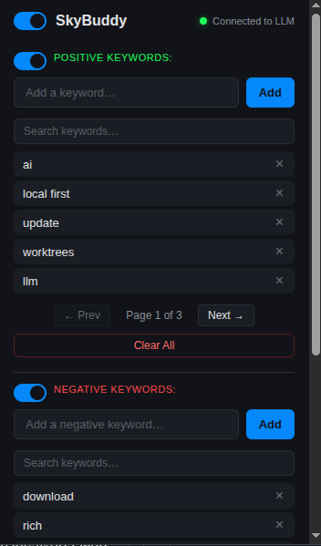
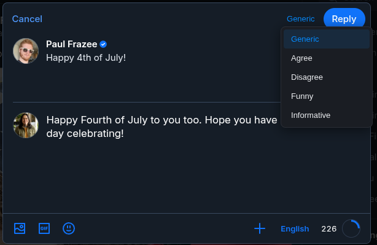
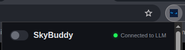
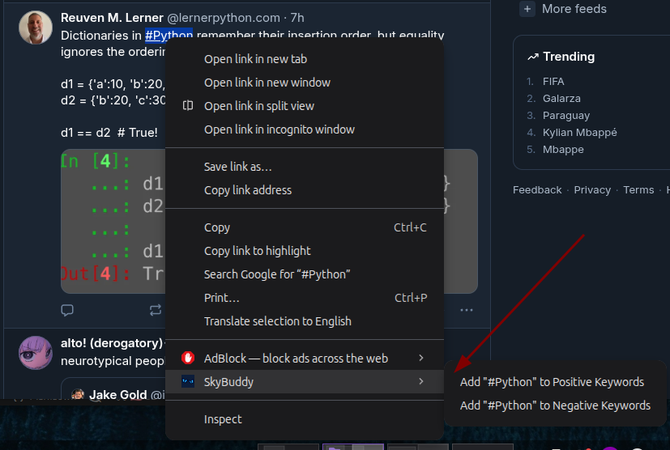
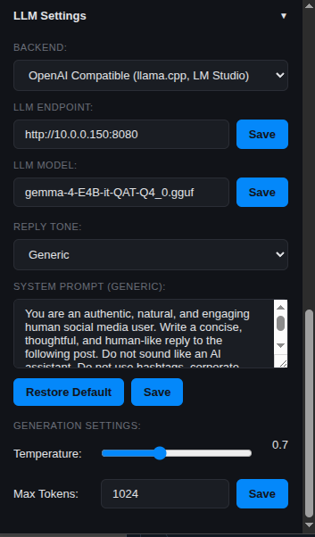

**SkyBuddy is retired.** Its development moved to [XBuddy](/projects/x-buddy/), a Chrome extension for X that does the same work with more to it. I wrote about the switch in [A Few Repos at a Time](/blog/a-few-repos-at-a-time/).

I wanted a way to monitor Bluesky for topics I actually care about without having to scroll endlessly or hand my data over to some third-party API.

This is what led me to build the extension.

**SkyBuddy** is a Chrome extension that runs on `bsky.app` and watches for posts matching your keywords. The matching posts get a configurable glow highlight so they stand out from the other posts. Posts you don't want to see get hidden entirely. And when you want to join the conversation, there's a Magic Reply button that drafts replies through your own local LLM.

## Features:

**Keyword Monitoring** - two independent keyword lists with toggles. Positive keywords give posts a configurable glow color (default blue). Negative keywords hide posts entirely with `display: none`. Each list has its own search, pagination, and clear button. Keywords are matched case-insensitively via substring.

**Magic Reply with Tones** - injects a button into Bluesky reply dialogs. Click it and SkyBuddy extracts the post text, sends it to your local LLM with a tone-specific system prompt, and inserts the generated reply into the composer. Five tones to choose from - Generic, Agree, Disagree, Funny, Informative - each with its own editable prompt that you can customize or restore to default.

**Privacy & Control** - a master toggle pauses everything without losing your settings. Full-config export/import as a versioned JSON file covers keywords, toggles, LLM config, tone prompts, temperature, max tokens, and glow color. No telemetry, no third-party API calls, no data leaving your machine except to the LLM endpoint you configure.

**Right-Click Integration** - right-click any hashtag on Bluesky to add it to your positive or negative keyword list. A toast notification confirms the action.

**Multiple Backend Support** - works with OpenAI-compatible endpoints (llama.cpp, LM Studio, LocalAI) and Ollama. Configure the URL, model name, temperature, and max tokens from the popup.

**LLM Status Indicator** - the popup header shows a live connection status dot with the LLM endpoint so you always know if your backend is reachable.

## Tech Stack

| Layer | |
|---|---|
| Platform | Chrome Extension Manifest V3 |
| Language | Vanilla JavaScript (no framework) |
| Storage | `chrome.storage.local` |
| DOM Observation | MutationObserver (rAF-throttled) |
| Styling | CSS custom properties, inline popup styles |
| LLM APIs | OpenAI-compatible `/v1/chat/completions` + Ollama `/api/chat` |
| Build | None - loaded unpacked, no bundler |

## Recent Updates:

- 7/4/2026 | v1.0.0 alpha - Keyword highlighting, negative filtering, Magic Reply with 5 tones, right-click integration, export/import, and full LLM backend support.

## Where It Went

SkyBuddy is retired. Its development moved to [XBuddy](/projects/x-buddy/), and the source is no longer public.

[Read about the switch →](/blog/a-few-repos-at-a-time/)
