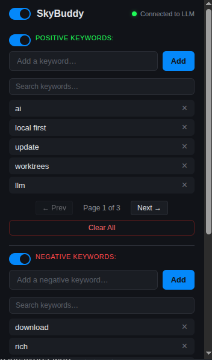
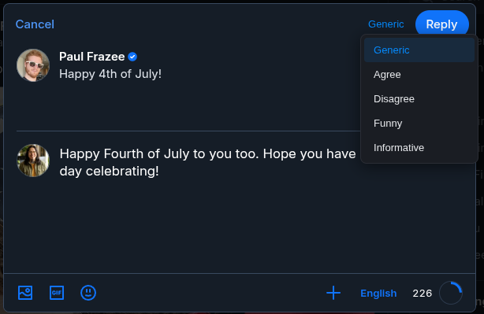
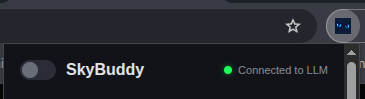
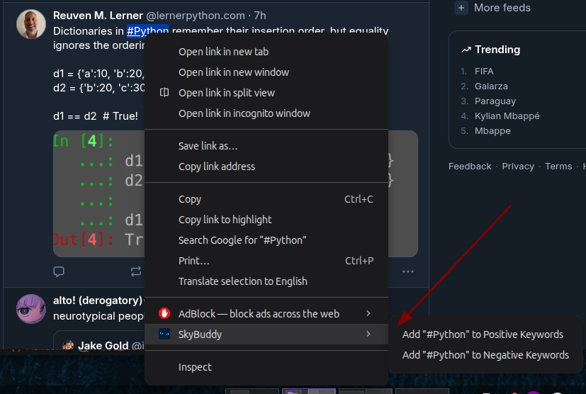
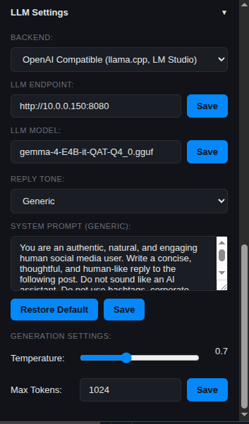

**SkyBuddy is retired.** I moved that work over to [XBuddy](/projects/x-buddy/) for X, which expands on the same ideas. I wrote about why I retired SkyBuddy in [A Few Repos at a Time](/blog/a-few-repos-at-a-time/).

I built SkyBuddy because I wanted to spot Bluesky posts I cared about without endless scrolling or sending my feed through a third-party cloud API. It ran on `bsky.app`, highlighted posts matching positive keywords with a colored glow, hid posts matching negative keywords, and added a Magic Reply button powered by a local LLM.

## Features

**Keyword monitoring:** Two toggleable keyword lists with search, pagination, and clear buttons, matching case-insensitively to either glow posts in a chosen color or hide them with `display: none`.

**Magic Reply with tones:** Adds a button in Bluesky reply dialogs that reads the post, runs a tone prompt (Generic, Agree, Disagree, Funny, or Informative) against your local LLM, and drops the draft into the composer for editing. All five prompts are customizable.

**Privacy and controls:** Includes a master pause toggle, right-click hashtag insertion into either list, versioned JSON export/import for all settings and prompts, and zero telemetry or cloud calls outside your configured local model endpoint.

**Local LLM backends:** Supports OpenAI-compatible servers (`llama.cpp`, LM Studio, LocalAI) and Ollama with configurable URL, model, temperature, max tokens, and a live connection indicator dot in the popup header.

## Tech stack

| Layer | Choice |
|---|---|
| Platform | Chrome Extension Manifest V3 |
| Language | Vanilla JavaScript (no framework) |
| Storage | `chrome.storage.local` |
| DOM Observation | MutationObserver (`rAF`-throttled) |
| Styling | CSS custom properties, inline popup styles |
| LLM APIs | OpenAI-compatible `/v1/chat/completions` + Ollama `/api/chat` |
| Build | None (loaded unpacked, no bundler) |

## Status

- 7/4/2026 | `v1.0.0` alpha: Keyword highlighting, negative filtering, Magic Reply with 5 tones, right-click insertion, export/import, and local LLM backend support.

SkyBuddy is retired and the source is no longer public; active development moved to [XBuddy](/projects/x-buddy/).

[Read about the switch](/blog/a-few-repos-at-a-time/)
