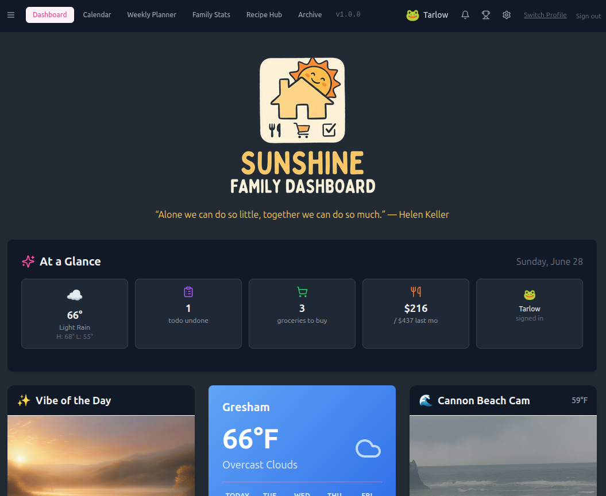
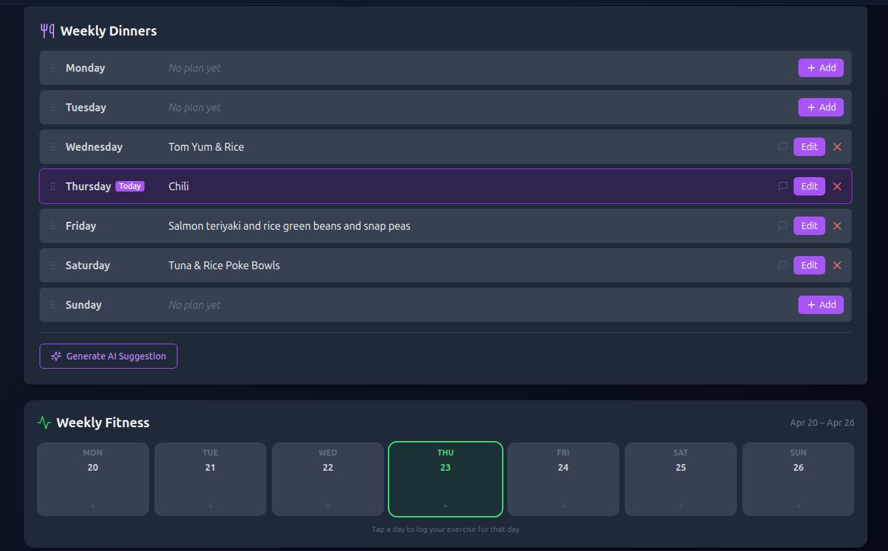
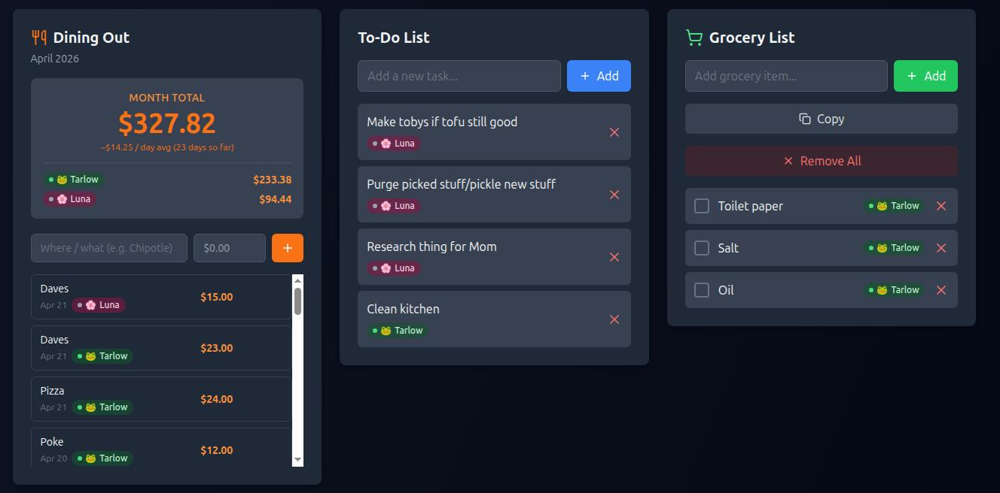
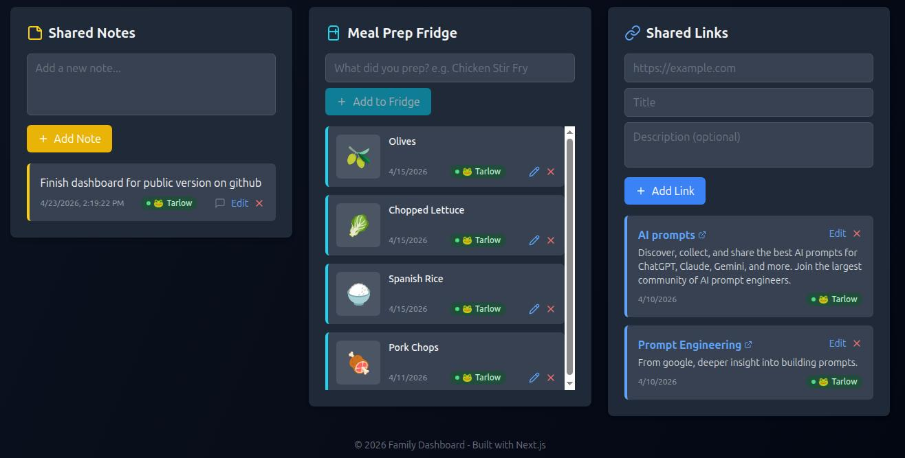

Sunshine Family Dashboard is a local-first web app that puts your household's week on one screen. Packaged in a single Docker container and built with Next.js and SQLite, it handles meal planning, recipes, grocery lists, todos, fitness logs, dining-out spending, shared notes, and more without cloud accounts or subscriptions.

Version 2 added a monthly calendar, a full weekly meal planner linked to a Recipe Hub (with automatic metadata fetching when you paste a link), a Family Stats page with monthly charts, an archive browser, PWA install support, and an At-a-Glance summary. If you connect a local LLM, it can also generate recipe ideas, custom toast messages, and a daily vibe message completely offline.

My wife and I use it every day, so I put it on GitHub in case another household finds it useful too.

## Daily household features

The Recipe Hub works like a shared cookbook: paste a recipe link and it pulls in the title, description, and image automatically, letting you rate and sort recipes. Inside the Weekly Meal Planner, you can `@`-mention saved recipes directly on any breakfast, lunch, or dinner slot and scroll through past or upcoming weeks.

Weekly Dinners lets everyone see what is planned each night, drag meals to different days when plans change, and leave quick comments. Weekly Fitness lets family members log workout days and earn small achievements.

The Dining Out panel tracks monthly restaurant spending overall and per person with month-over-month comparisons. The To-Do List supports optional daily, weekly, or monthly recurring reminders, and the Grocery List groups items into color-coded categories (including custom categories) so you can copy your list into an app like Google Keep before heading to the store.

Shared Notes and Shared Links keep household announcements and useful bookmarks in one spot, while Meal Prep Fridge tracks leftovers with the date they were stored and a local-LLM-picked emoji and best-by estimate.

The Calendar gives each family member one of 12 accent colors for birthdays, appointments, and school events. Family Stats charts monthly dining spend, workouts, completed todos, and photo uploads, while the Archive page lets you recover deleted notes or todos. Everything installs as a PWA with responsive navigation and includes full JSON database export/import for backups.

## Features

- Local member profiles with per-member theme, background, and 12-color accent picker
- Monthly calendar with color-coded events
- Weekly meal planner with breakfast/lunch/dinner slots and recipe `@`-linking
- Recipe Hub with auto-fetched metadata, ratings, categories, and search
- Weekly dinner planner with drag-to-reorder, comments, and local AI suggestions
- Fitness tracker with weekly logs and achievements
- Dining-out expense tracker with per-member totals and month-over-month comparisons
- To-do list with optional daily, weekly, or monthly reminders
- Grocery list with custom color-coded categories
- Shared notes with comments, shared links board, and Meal Prep Fridge tracker
- Family Stats bar charts, searchable Archive page, and At-a-Glance summary widget
- OpenWeatherMap widget, live camera snapshot (auto-refreshing), and photo carousel
- Local LLM daily vibe messages and smart meal-prep best-by estimates
- Per-member panel visibility controls, light/dark mode, and auto-refresh timer
- PWA support and full JSON database backup/restore

## Tech stack

Built with Next.js 15, TypeScript, Tailwind CSS, Prisma with SQLite, cookie-based household member sessions (no passwords to juggle on a home network), and optional local LLM integration so private family data stays on your own hardware.

## Recent updates

- 6/27/2026 | [GitHub](https://github.com/DevTarlow/Sunshine-Family-Dashboard/releases/tag/v2.0.0) v2.0.0 - Calendar, Weekly Planner, Recipe Hub, Stats, and PWA support.
- 4/26/2026 | [GitHub](https://github.com/DevTarlow/Sunshine-Family-Dashboard/releases/tag/v1.0.0) Initial 1.0.0 release.

## Get the project

Sunshine Family Dashboard is free and open source. Grab it from GitHub and run it on your own local server.

<a href="https://github.com/DevTarlow/sunshine-family-dashboard" class="project-link" target="_blank" rel="noopener noreferrer">
  <svg xmlns="http://www.w3.org/2000/svg" width="16" height="16" viewBox="0 0 24 24" fill="none" stroke="currentColor" stroke-width="2" stroke-linecap="round" stroke-linejoin="round">
    <path d="M9 19c-5 1.5-5-2.5-7-3m14 6v-3.87a3.37 3.37 0 0 0-.94-2.61c3.14-.35 6.44-1.54 6.44-7A5.44 5.44 0 0 0 20 4.77 5.07 5.07 0 0 0 19.91 1S18.73.65 16 2.48a13.38 13.38 0 0 0-7 0C6.27.65 5.09 1 5.09 1A5.07 5.07 0 0 0 5 4.77a5.44 5.44 0 0 0-1.5 3.78c0 5.42 3.3 6.61 6.44 7A3.37 3.37 0 0 0 9 18.13V22"></path>
  </svg>
  View on GitHub
</a>
